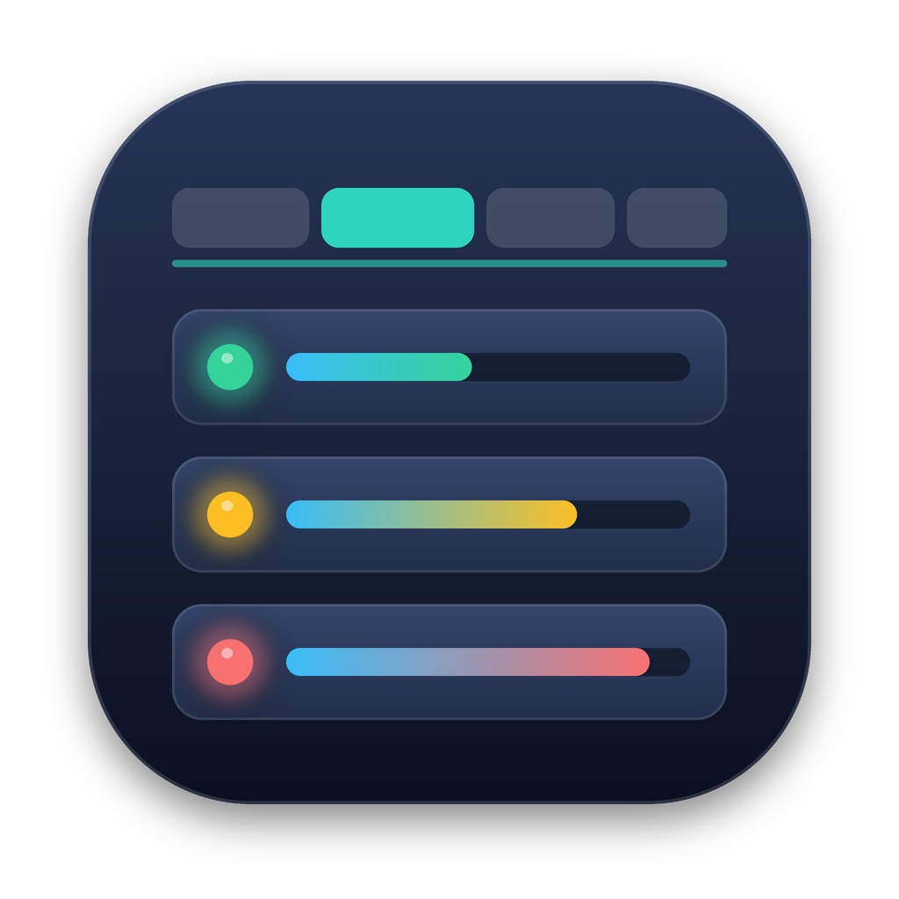
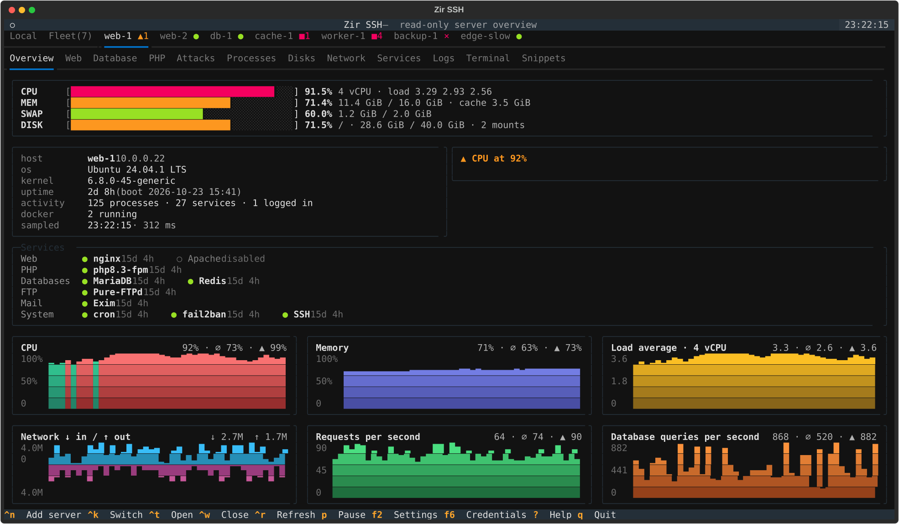
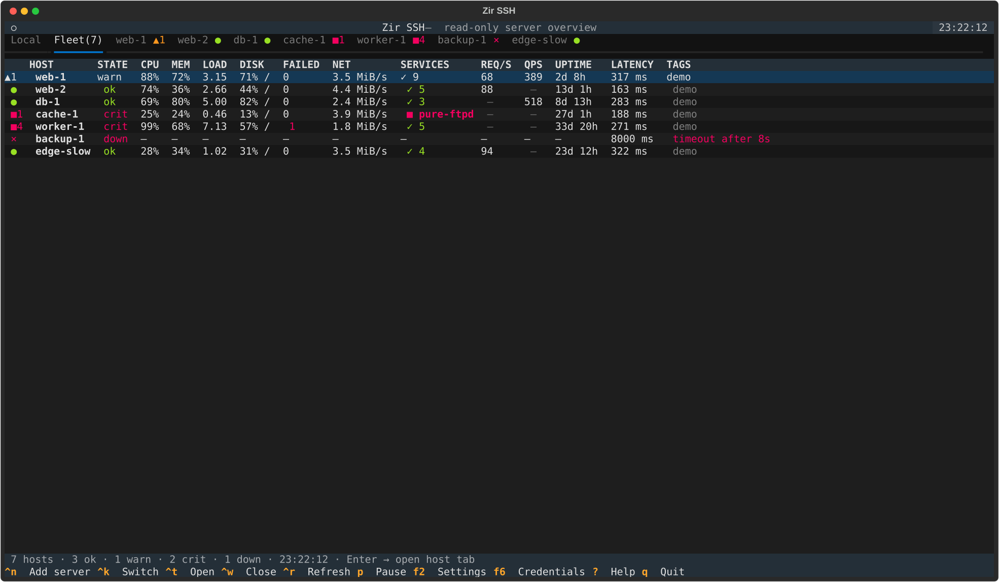
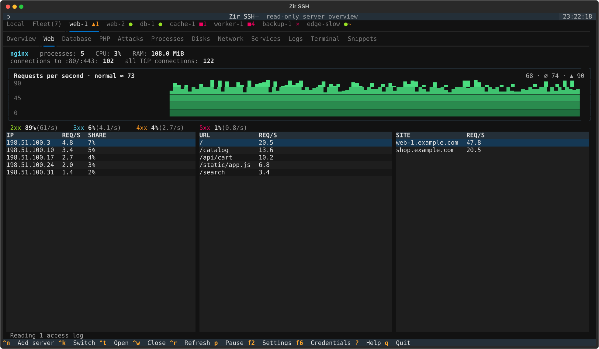
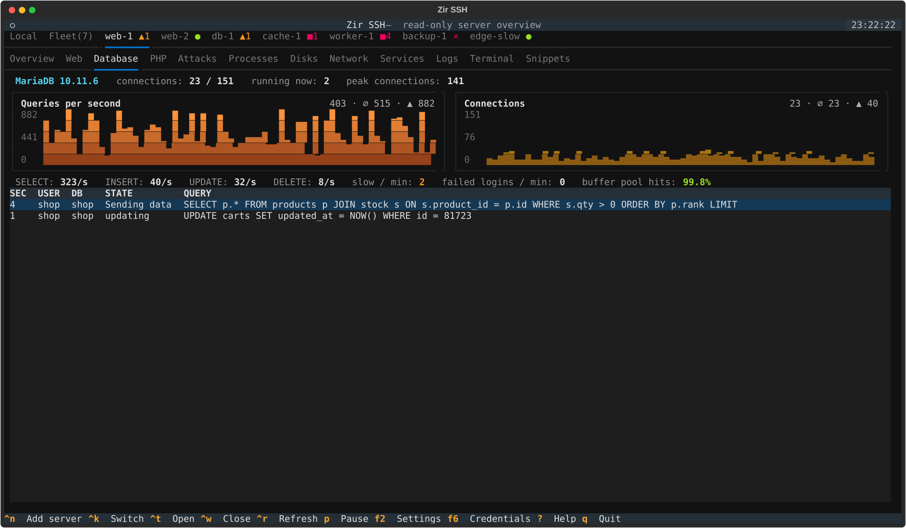
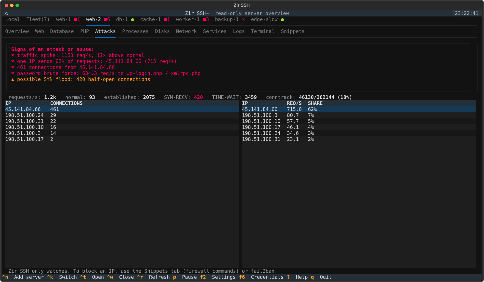
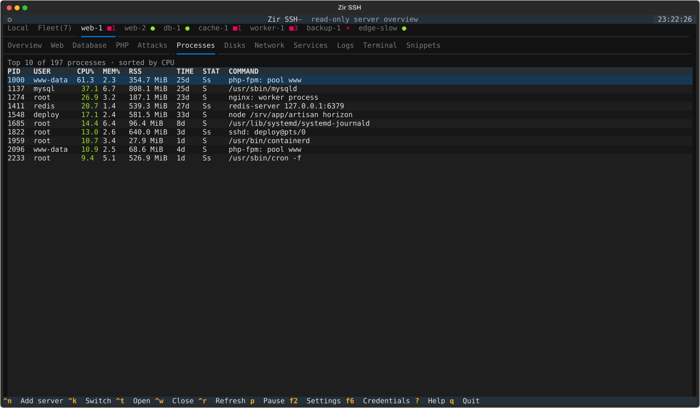

<p align="center">
  
</p>

<h1 align="center">Zir SSH</h1>

<p align="center">
  <b>A read-only dashboard for one or many Linux servers, right in your terminal. Agentless: SSH is all it needs.</b>
</p>

<p align="center">
  <a href="https://github.com/LavrinchukAndrii/zir-ssh/actions/workflows/tests.yml"></a>
  
  
  
  <a href="LICENSE"></a>
</p>

<p align="center">
  <b>English</b> · <a href="README.uk.md">Українська</a>
</p>

<p align="center">
  
</p>

Zir SSH connects to your servers over plain SSH (the same keys and `~/.ssh/config` you already use),
runs a few read-only commands and shows what is going on: load, memory, disks, web traffic,
databases, PHP-FPM pools, suspicious traffic, processes, services and logs. Every server gets its
own tab, **Fleet** shows all of them at once, and a built-in terminal opens a shell on any of them
instantly. Nothing has to be installed on the servers.

## Contents

- [Features](#features)
- [Screenshots](#screenshots)
- [Install](#install)
- [Quick start](#quick-start)
- [Configuration](#configuration)
- [Keyboard](#keyboard)
- [Language](#language)
- [Security and privacy](#security-and-privacy)
- [Building from source](#building-from-source)
- [Development](#development)
- [Contributing](#contributing)
- [License](#license)

## Features

- **Fleet view.** One table with every server: state, CPU, memory, load, disk, network, failed
  services, requests and queries per second, uptime, latency. Tabs carry badges:
  `●` ok · `▲` warn · `■` crit · `×` unreachable · `·` pending · `~` stale · `‖` paused · `⊘` disabled,
  plus the number of findings.
- **Overview.** CPU, memory, swap and disk gauges; every known service grouped as Web (nginx,
  Apache, LiteSpeed, Caddy), PHP-FPM, databases (MariaDB, MySQL, PostgreSQL, Redis…), FTP, mail,
  DNS, hosting panels and system services; charts for CPU, memory, load, network, requests per
  second and database queries per second. An enabled service that is not running is a critical finding.
- **Web.** Web server processes, CPU and RAM, requests per second from the access logs (read
  incrementally), response codes, top IPs, top URLs and per-site load.
- **Database.** MySQL / MariaDB queries per second, connections vs `max_connections`, running and
  slow queries, failed logins, buffer pool hit rate.
- **PHP.** PHP-FPM pools, busy workers vs `pm.max_children`, CPU, RAM, "max_children reached".
- **Attacks.** Traffic spikes vs the normal level, one IP sending a large share of requests, many
  connections per IP, SYN flood, conntrack table, brute force on `wp-login.php` / `xmlrpc.php`.
  Private addresses (proxies, Docker) are never blamed.
- **Processes, Disks, Network, Services, Logs.** The usual suspects, as tables.
- **Terminal.** Real SSH sessions to the host, several at once (Alt+T / Alt+W). They reuse the
  monitoring connection, so they open instantly. Mouse support for htop, mc, vim; drag to copy,
  right click to paste. The very first tab, **Local**, is a terminal on your own computer.
- **Snippets.** "Check server" looks at what is installed and prepares the commands that matter
  for it: nginx/Apache tests and reloads, PHP-FPM, MySQL, Docker, firewall, fail2ban, certbot,
  Laravel, WordPress… "Insert" types a command into the terminal without running it.
- **Identity cards.** Saved logins and passwords (F6). When the terminal asks for a password
  (`sudo`, `su -`, `Enter passphrase…`) a list pops up; picking a card types its password.
  Stored encrypted on your computer, see [Security and privacy](#security-and-privacy).
- **Scriptable.** `zir --report --json web-1` prints a one-shot report for cron or CI.
- **Cross-platform.** Single-file builds for macOS (with a `.app` in a `.dmg`), Linux and Windows.

## Screenshots

All screenshots are taken from the built-in demo (`zir --demo`), so you can see the same thing
without any servers.

| Fleet | Web |
|---|---|
|  |  |
| **Database** | **Attacks** |
|  |  |
| **Processes** | **Overview** |
|  |  |

## Install

### Download a release

Grab the file for your system from [Releases](https://github.com/LavrinchukAndrii/zir-ssh/releases):

| System | File |
|---|---|
| macOS on Apple Silicon (M1 and newer) | `zir-macos-arm64.dmg` |
| Windows 10/11 | `zir-windows-x86_64.exe` |
| Linux x86_64 / ARM64 (glibc 2.35+) | `zir-linux-x86_64` / `zir-linux-arm64` |

- **macOS:** open the `.dmg` and drag `zir.app` to Applications. The app is not signed with an
  Apple certificate yet, so the first time right-click it → Open
  (or `xattr -dr com.apple.quarantine /Applications/zir.app`).
  Intel Macs are not supported: Apple has ended the Intel line, and macOS 26 is the last version for it.
- **Windows:** needs the built-in OpenSSH Client (Settings → Optional features). Run it in Windows Terminal.
- **Linux:** `chmod +x zir-linux-x86_64`; `zir --install-desktop` adds it with its icon to the app menu.

Checksums are in `SHA256SUMS` next to the files. More details: [docs/BUILD.md](docs/BUILD.md) (in Ukrainian).

### From source

Requires Python 3.11+ and an `ssh` client.

```sh
git clone https://github.com/LavrinchukAndrii/zir-ssh.git
cd zir-ssh
python3 -m venv .venv && .venv/bin/pip install -e .
.venv/bin/zir --demo
```

## Quick start

```sh
zir --demo                  # fake fleet, no SSH needed
zir web-1 db-1              # SSH aliases from ~/.ssh/config or user@host[:port]
zir                         # all hosts from the config file
zir --report --json web-1   # one-shot report for cron/CI
zir --lang en               # English interface
```

Started without any hosts, Zir SSH shows a first-run screen: pick hosts from `~/.ssh/config`,
type addresses, or open the demo.

**Password-only servers.** If a server rejects your SSH key, Zir SSH asks for its password once and
adds your public key to `~/.ssh/authorized_keys` there (like `ssh-copy-id`; it creates
`~/.ssh/id_ed25519` if you have no key). The password is not stored. Press `a` to do it later.

## Configuration

`~/.config/zir/hosts.toml` (Windows: `%APPDATA%\zir\hosts.toml`). Servers can also be added from the
app with Ctrl+N. A full example is in [hosts.example.toml](hosts.example.toml):

```toml
[settings]
interval = 2.0                # seconds between polls of the visible tab
hidden_interval_factor = 3    # background tabs poll 3x less often

[hosts]
web-1 = "deploy@10.0.0.5"     # short form: name = "ssh destination"

[hosts.db-1]
title = "Database (production)"
target = "db-1"               # alias from ~/.ssh/config
tags = ["prod", "db"]
interval = 5.0
```

Per-host options: `title`, `target`, `port`, `identity`, `tags`, `interval`, `strict_host_key`,
`web_logs` (extra access log globs), `ssh_options` (any `ssh -o` option, e.g. `ProxyJump=bastion`),
`enabled`. Open tabs, their order, the active tab and section are restored on the next start
(`--reset-layout` forgets them).

## Keyboard

| Key | Action |
|---|---|
| `Ctrl+PgDn` / `Ctrl+PgUp` (also `Ctrl+Tab` / `Ctrl+Shift+Tab`) | next / previous server tab |
| `Alt+1..9` | jump to tab by number: 1 = Local, 2 = Fleet (Option+1..9 on a Mac) |
| `Ctrl+K` | find a host by name, tag or address |
| `Ctrl+N` / `Delete` | add a new server / remove the current one (saved in hosts.toml) |
| `Ctrl+T` / `Ctrl+W` | open a closed host / close the current tab |
| `[` / `]`, `F3` / `F4` | previous / next section (F3/F4 also while typing in the terminal) |
| `Alt+T` / `Alt+W` | new / close terminal session |
| `Ctrl+R` | poll all hosts now |
| `p` / `P` | pause this host / all hosts |
| `a` | add your SSH key to the host (asks for its password once) |
| `d` | disable / enable a host: no SSH at all while disabled |
| `F2` | settings: interface language, human names of the servers |
| `F6` | identity cards: logins and passwords for the terminal |
| `?` | help |
| `q` | quit (asks first if some host is crit or down) |

While the terminal has focus, letters and most Ctrl keys go to the shell; Ctrl+PgUp/PgDn,
Alt+digits and F3/F4 still switch tabs. Dragging the mouse over any text copies it to the
clipboard (also over SSH via OSC 52); in tables Ctrl+C or `y` copies the selected row.

## Language

The interface is Ukrainian by default. Switch to English with **F2 → Settings** (also on the
first-run screen); the choice is saved to `~/.config/zir/prefs.json`. One-off: `zir --lang en` or
`ZIR_LANG=en`. Priority: `--lang` > `ZIR_LANG` > F2 choice > `language` in hosts.toml > Ukrainian.
`--report --json` keys and states are always English.

## Security and privacy

- **Monitoring is read-only.** Zir SSH only runs commands that read state (`/proc`, `ps`, `ss`,
  `systemctl show`, log tails, `SHOW STATUS`). Commands in the terminal are the ones you type;
  snippets are only typed, never run.
- **It writes to a server only when you ask it to:** your public key into
  `~/.ssh/authorized_keys` (after you enter the server password), and `~/.my.cnf` with mode 0600
  when you set up database access (after the login is checked with `SELECT 1`; an existing file is
  backed up first).
- **No agents, no telemetry.** It talks to nothing but your servers, using your system `ssh`.
- **Identity cards** are kept in `~/.config/zir/credentials.enc`, encrypted with AES-256-GCM by a
  key derived from your private SSH key (`~/.ssh/id_ed25519`, `id_ecdsa` or `id_rsa`). They cannot be
  read on another computer; anyone who can read your private key can read them too, and if you
  replace that key the cards cannot be opened any more (Zir SSH warns and does not overwrite the file).

Found a vulnerability? Please report it privately, see [SECURITY.md](SECURITY.md).

## Building from source

```sh
make build        # this computer -> dist/ (on macOS also the .app and .dmg)
make build-all    # every system via GitHub Actions -> dist/
```

PyInstaller, icons, the `.dmg` window, releases and a Docker test server: [docs/BUILD.md](docs/BUILD.md).

## Development

```sh
python3 -m venv .venv && .venv/bin/pip install -e '.[dev]'
.venv/bin/zir --demo --demo-hosts 20
make test
python scripts/screenshots.py   # regenerate docs/screenshots from the demo
```

Built with [Textual](https://github.com/Textualize/textual) and [Rich](https://github.com/Textualize/rich);
the terminal emulation uses [pyte](https://github.com/selectel/pyte), and the macOS app window
uses [pywebview](https://pywebview.flowrl.com) with [xterm.js](https://xtermjs.org)
(MIT, see [zir/assets/term/LICENSE-xterm.txt](zir/assets/term/LICENSE-xterm.txt)).

## Contributing

Bug reports, ideas and pull requests are welcome. Please read [CONTRIBUTING.md](CONTRIBUTING.md)
first. Changes are listed in [CHANGELOG.md](CHANGELOG.md).

## License

© 2026 Lavrinchuk Andrii. Zir SSH is **free for personal, non-commercial use** under the
[PolyForm Noncommercial License 1.0.0](LICENSE): you may use it for yourself, study it, change it and
share it, as long as it is not for commercial purposes. Selling it, bundling it into a paid product or
service, or using it in a company's commercial work is not allowed without a separate license;
for that, write to lavrinchuk.a@gmail.com.

The source code is public, but because of the non-commercial clause this is *source-available*
software, not "open source" in the OSI sense. Third-party components keep their own licenses
(xterm.js: MIT).
