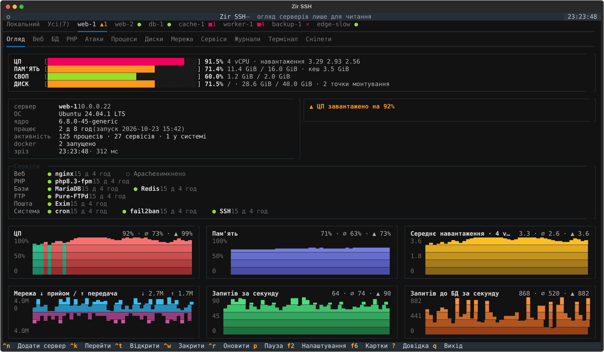
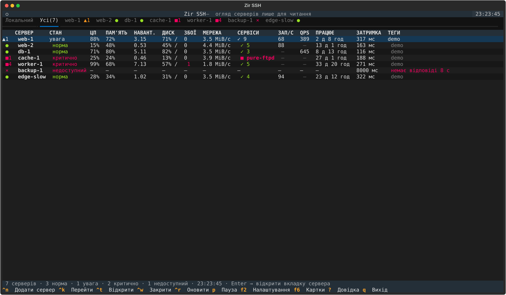
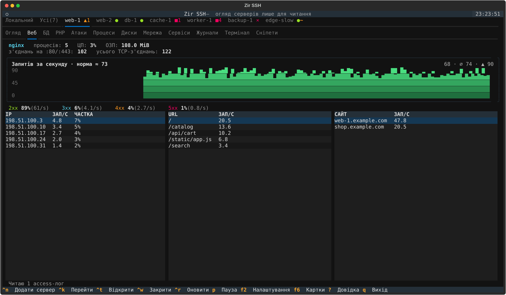
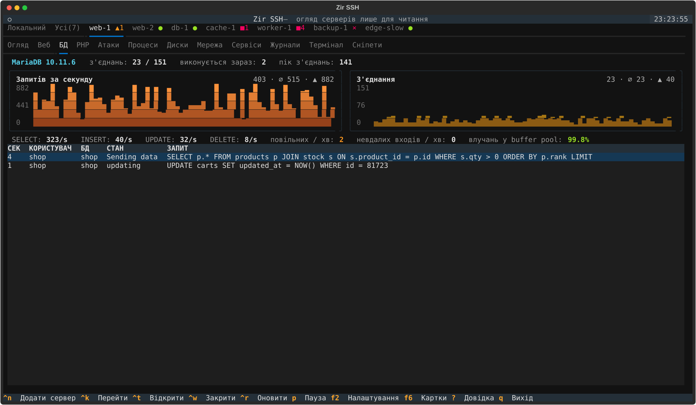
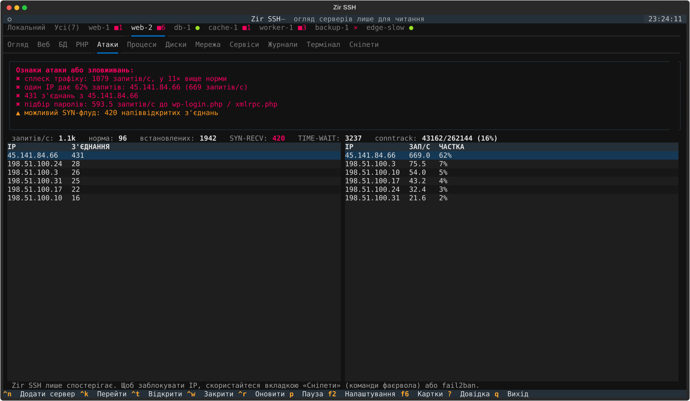
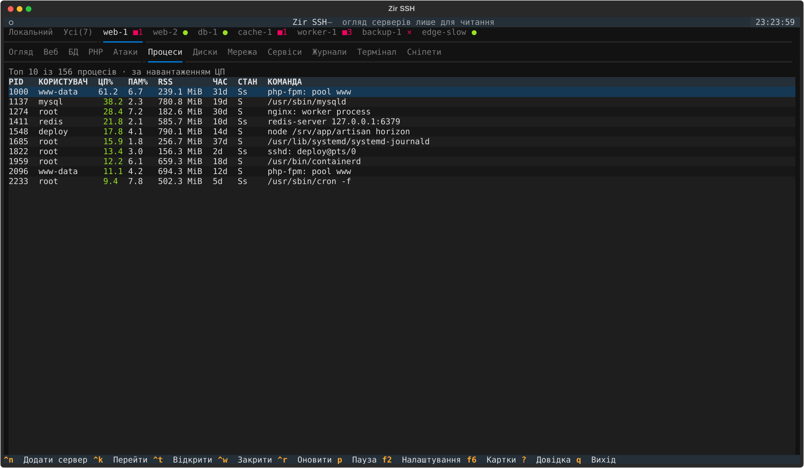

<p align="center">
  
</p>

<h1 align="center">Zir SSH</h1>

<p align="center">
  <b>Панель стану одного чи багатьох Linux-серверів просто в терміналі, лише для читання. Без агентів: потрібен тільки SSH.</b>
</p>

<p align="center">
  <a href="https://github.com/LavrinchukAndrii/zir-ssh/actions/workflows/tests.yml"></a>
  
  
  
  <a href="LICENSE"></a>
</p>

<p align="center">
  <a href="README.md">English</a> · <b>Українська</b>
</p>

<p align="center">
  
</p>

Zir SSH під'єднується до серверів звичайним SSH (ті самі ключі й `~/.ssh/config`, якими ви вже
користуєтесь), виконує кілька команд, що лише читають стан, і показує, що відбувається:
навантаження, пам'ять, диски, веб-трафік, бази даних, пули PHP-FPM, підозрілий трафік, процеси,
сервіси та журнали. Кожен сервер має власну вкладку, **Усі** показує їх разом, а вбудований
термінал миттєво відкриває shell на будь-якому з них. На сервери нічого встановлювати не треба.

## Зміст

- [Можливості](#можливості)
- [Знімки екрана](#знімки-екрана)
- [Встановлення](#встановлення)
- [Швидкий старт](#швидкий-старт)
- [Налаштування](#налаштування)
- [Клавіші](#клавіші)
- [Мова](#мова)
- [Безпека та приватність](#безпека-та-приватність)
- [Збірка з коду](#збірка-з-коду)
- [Розробка](#розробка)
- [Участь у проєкті](#участь-у-проєкті)
- [Ліцензія](#ліцензія)

## Можливості

- **Усі сервери.** Одна таблиця з кожним сервером: стан, ЦП, пам'ять, навантаження, диск, мережа,
  збійні сервіси, запити й запити до БД за секунду, час роботи, затримка. На вкладках є значки:
  `●` норма · `▲` увага · `■` критично · `×` недоступний · `·` очікування · `~` застарілі дані ·
  `‖` пауза · `⊘` вимкнено, а також кількість проблем.
- **Огляд.** Шкали ЦП, пам'яті, свопу й дисків; стан кожного відомого сервісу за групами: веб
  (nginx, Apache, LiteSpeed, Caddy), PHP-FPM, бази даних (MariaDB, MySQL, PostgreSQL, Redis…), FTP,
  пошта, DNS, панелі хостингу й системні сервіси; графіки ЦП, пам'яті, навантаження, мережі,
  запитів за секунду та запитів до БД за секунду. Увімкнений, але не запущений сервіс — це критична проблема.
- **Веб.** Процеси веб-сервера, ЦП і пам'ять, запити за секунду з журналів доступу (читаються
  частинами), коди відповідей, найактивніші IP, адреси сторінок і навантаження за сайтами.
- **БД.** Запити за секунду в MySQL / MariaDB, з'єднання проти `max_connections`, поточні й
  повільні запити, невдалі входи, влучання в буферний пул.
- **PHP.** Пули PHP-FPM, зайняті процеси проти `pm.max_children`, ЦП, пам'ять, «max_children reached».
- **Атаки.** Сплески трафіку порівняно зі звичайним рівнем, одна IP-адреса з великою часткою запитів,
  багато з'єднань з однієї адреси, SYN flood, таблиця conntrack, підбір паролів до `wp-login.php` /
  `xmlrpc.php`. Приватні адреси (проксі, Docker) ніколи не вважаються винними.
- **Процеси, Диски, Мережа, Сервіси, Журнали.** Усе звичне, у вигляді таблиць.
- **Термінал.** Справжні SSH-сесії до сервера, кілька одночасно (Alt+T / Alt+W). Вони використовують
  те саме з'єднання, що й моніторинг, тому відкриваються миттєво. Мишка працює в htop, mc, vim;
  виділення копіює, правий клік вставляє. Найперша вкладка, **Локальний**, — термінал на вашому комп'ютері.
- **Сніпети.** «Перевірити сервер» дивиться, що встановлено, і готує потрібні саме для нього
  команди: перевірка й перезавантаження nginx/Apache, PHP-FPM, MySQL, Docker, брандмауер, fail2ban,
  certbot, Laravel, WordPress… «Вставити» друкує команду в терміналі, не запускаючи її.
- **Картки доступу.** Збережені логіни й паролі (F6). Коли термінал питає пароль (`sudo`, `su -`,
  `Enter passphrase…`), з'являється список; вибір картки друкує її пароль. Зберігаються
  зашифрованими на вашому комп'ютері, див. [Безпека та приватність](#безпека-та-приватність).
- **Для скриптів.** `zir --report --json web-1` друкує разовий звіт для cron або CI.
- **Усі системи.** Збірки одним файлом для macOS (`.app` у `.dmg`), Linux і Windows.

## Знімки екрана

Усі знімки зроблено з вбудованого демо (`zir --demo`), тож те саме можна побачити без жодного сервера.

| Усі сервери | Веб |
|---|---|
|  |  |
| **БД** | **Атаки** |
|  |  |
| **Процеси** | **Огляд** |
|  |  |

## Встановлення

### Готовий реліз

Завантажте файл для своєї системи з [Releases](https://github.com/LavrinchukAndrii/zir-ssh/releases):

| Система | Файл |
|---|---|
| macOS на Apple Silicon (M1 і новіші) | `zir-macos-arm64.dmg` |
| Windows 10/11 | `zir-windows-x86_64.exe` |
| Linux x86_64 / ARM64 (glibc 2.35+) | `zir-linux-x86_64` / `zir-linux-arm64` |

- **macOS:** відкрийте `.dmg` і перетягніть `zir.app` у «Програми». Програма поки не підписана
  сертифікатом Apple, тому вперше відкрийте її правим кліком → «Відкрити»
  (або `xattr -dr com.apple.quarantine /Applications/zir.app`).
  Mac з процесором Intel не підтримуються: Apple припинила їх випуск, а macOS 26 — остання версія для них.
- **Windows:** потрібен вбудований OpenSSH Client (Параметри → Додаткові компоненти). Запускайте у Windows Terminal.
- **Linux:** `chmod +x zir-linux-x86_64`; `zir --install-desktop` додає програму з іконкою в меню застосунків.

Контрольні суми лежать у `SHA256SUMS` поруч із файлами. Докладніше: [docs/BUILD.md](docs/BUILD.md).

### З коду

Потрібні Python 3.11+ і клієнт `ssh`.

```sh
git clone https://github.com/LavrinchukAndrii/zir-ssh.git
cd zir-ssh
python3 -m venv .venv && .venv/bin/pip install -e .
.venv/bin/zir --demo
```

## Швидкий старт

```sh
zir --demo                  # демо-сервери, SSH не потрібен
zir web-1 db-1              # аліаси з ~/.ssh/config або user@host[:port]
zir                         # усі сервери з файлу налаштувань
zir --report --json web-1   # разовий звіт для cron/CI
zir --lang en               # англійський інтерфейс
```

Якщо запустити Zir SSH без серверів, з'явиться екран першого запуску: виберіть сервери з
`~/.ssh/config`, введіть адреси або відкрийте демо.

**Сервери лише з паролем.** Якщо сервер не приймає ваш SSH-ключ, Zir SSH один раз попросить його
пароль і додасть ваш публічний ключ у `~/.ssh/authorized_keys` на сервері (як `ssh-copy-id`; якщо
ключа немає, створить `~/.ssh/id_ed25519`). Пароль не зберігається. Зробити це пізніше — клавіша `a`.

## Налаштування

`~/.config/zir/hosts.toml` (Windows: `%APPDATA%\zir\hosts.toml`). Сервери можна додавати й у самій
програмі через Ctrl+N. Повний приклад — [hosts.example.toml](hosts.example.toml):

```toml
[settings]
interval = 2.0                # секунд між опитуваннями видимої вкладки
hidden_interval_factor = 3    # фонові вкладки опитуються втричі рідше

[hosts]
web-1 = "deploy@10.0.0.5"     # коротка форма: назва = "адреса ssh"

[hosts.db-1]
title = "База даних (продакшн)"
target = "db-1"               # аліас з ~/.ssh/config
tags = ["prod", "db"]
interval = 5.0
```

Параметри сервера: `title`, `target`, `port`, `identity`, `tags`, `interval`, `strict_host_key`,
`web_logs` (додаткові шаблони журналів доступу), `ssh_options` (будь-який параметр `ssh -o`,
наприклад `ProxyJump=bastion`), `enabled`. Відкриті вкладки, їхній порядок, активна вкладка й
розділ відновлюються під час наступного запуску (`--reset-layout` їх забуває).

## Клавіші

| Клавіша | Дія |
|---|---|
| `Ctrl+PgDn` / `Ctrl+PgUp` (також `Ctrl+Tab` / `Ctrl+Shift+Tab`) | наступна / попередня вкладка сервера |
| `Alt+1..9` | перехід на вкладку за номером: 1 = Локальний, 2 = Усі (на Mac — Option+1..9) |
| `Ctrl+K` | знайти сервер за назвою, тегом чи адресою |
| `Ctrl+N` / `Delete` | додати сервер / видалити поточний (зберігається в hosts.toml) |
| `Ctrl+T` / `Ctrl+W` | відкрити закритий сервер / закрити поточну вкладку |
| `[` / `]`, `F3` / `F4` | попередній / наступний розділ (F3/F4 працюють і під час введення в терміналі) |
| `Alt+T` / `Alt+W` | нова / закрити сесію термінала |
| `Ctrl+R` | опитати всі сервери зараз |
| `p` / `P` | пауза цього сервера / усіх |
| `a` | додати ваш SSH-ключ на сервер (один раз запитає пароль) |
| `d` | вимкнути / увімкнути сервер: поки вимкнено, SSH не використовується зовсім |
| `F2` | налаштування: мова інтерфейсу, зрозумілі назви серверів |
| `F6` | картки доступу: логіни й паролі для термінала |
| `?` | довідка |
| `q` | вихід (спершу перепитає, якщо якийсь сервер у критичному стані чи недоступний) |

Коли фокус у терміналі, літери й більшість Ctrl-клавіш ідуть у shell; Ctrl+PgUp/PgDn, Alt+цифри та
F3/F4 і далі перемикають вкладки. Виділення мишкою будь-якого тексту копіює його в буфер обміну
(також через SSH за допомогою OSC 52); у таблицях Ctrl+C або `y` копіює вибраний рядок.

## Мова

Інтерфейс типово український. Перемкнути на англійську можна через **F2 → Налаштування** (також на
екрані першого запуску); вибір зберігається в `~/.config/zir/prefs.json`. Разово: `zir --lang en`
або `ZIR_LANG=en`. Пріоритет: `--lang` > `ZIR_LANG` > вибір у F2 > `language` у hosts.toml > українська.
Ключі й стани у `--report --json` завжди англійською.

## Безпека та приватність

- **Моніторинг лише читає.** Zir SSH запускає тільки команди, що читають стан (`/proc`, `ps`, `ss`,
  `systemctl show`, кінці журналів, `SHOW STATUS`). У терміналі виконується лише те, що ви вводите;
  сніпети тільки друкуються, але не запускаються.
- **На сервер щось пишеться лише на ваше прохання:** ваш публічний ключ у
  `~/.ssh/authorized_keys` (після введення пароля сервера) і `~/.my.cnf` з правами 0600, коли ви
  налаштовуєте доступ до бази даних (після перевірки входу через `SELECT 1`; наявний файл спершу
  зберігається як резервна копія).
- **Без агентів і телеметрії.** Програма спілкується лише з вашими серверами через системний `ssh`.
- **Картки доступу** зберігаються в `~/.config/zir/credentials.enc`, зашифровані AES-256-GCM ключем,
  отриманим з вашого приватного SSH-ключа (`~/.ssh/id_ed25519`, `id_ecdsa` або `id_rsa`). Їх не
  прочитати на іншому комп'ютері; хто може прочитати ваш приватний ключ, той прочитає й картки, а
  якщо ключ замінити, картки більше не відкриються (Zir SSH попередить і не перезапише файл).

Знайшли вразливість? Повідомте приватно, див. [SECURITY.md](SECURITY.md).

## Збірка з коду

```sh
make build        # цей комп'ютер -> dist/ (на macOS також .app і .dmg)
make build-all    # усі системи через GitHub Actions -> dist/
```

PyInstaller, іконки, вікно `.dmg`, релізи й тестовий сервер у Docker: [docs/BUILD.md](docs/BUILD.md).

## Розробка

```sh
python3 -m venv .venv && .venv/bin/pip install -e '.[dev]'
.venv/bin/zir --demo --demo-hosts 20
make test
python scripts/screenshots.py   # перегенерувати docs/screenshots з демо
```

Побудовано на [Textual](https://github.com/Textualize/textual) і [Rich](https://github.com/Textualize/rich);
емуляція термінала — [pyte](https://github.com/selectel/pyte), вікно програми на macOS —
[pywebview](https://pywebview.flowrl.com) з [xterm.js](https://xtermjs.org)
(MIT, див. [zir/assets/term/LICENSE-xterm.txt](zir/assets/term/LICENSE-xterm.txt)).

## Участь у проєкті

Повідомлення про помилки, ідеї та pull request'и вітаються. Спершу прочитайте
[CONTRIBUTING.md](CONTRIBUTING.md). Зміни описано в [CHANGELOG.md](CHANGELOG.md).

## Ліцензія

© 2026 Lavrinchuk Andrii. Zir SSH **безкоштовний для особистого некомерційного використання** за
ліцензією [PolyForm Noncommercial License 1.0.0](LICENSE): програмою можна користуватися для себе,
вивчати, змінювати й поширювати, якщо це не з комерційною метою. Продавати її, включати в платний
продукт чи послугу або використовувати в комерційній роботі компанії без окремої ліцензії не можна;
щодо цього пишіть на lavrinchuk.a@gmail.com.

Код відкритий для перегляду, але через заборону комерційного використання це *source-available*,
а не «open source» у розумінні OSI. Сторонні компоненти мають власні ліцензії (xterm.js: MIT).
Юридично чинним є англійський текст ліцензії у файлі [LICENSE](LICENSE).
